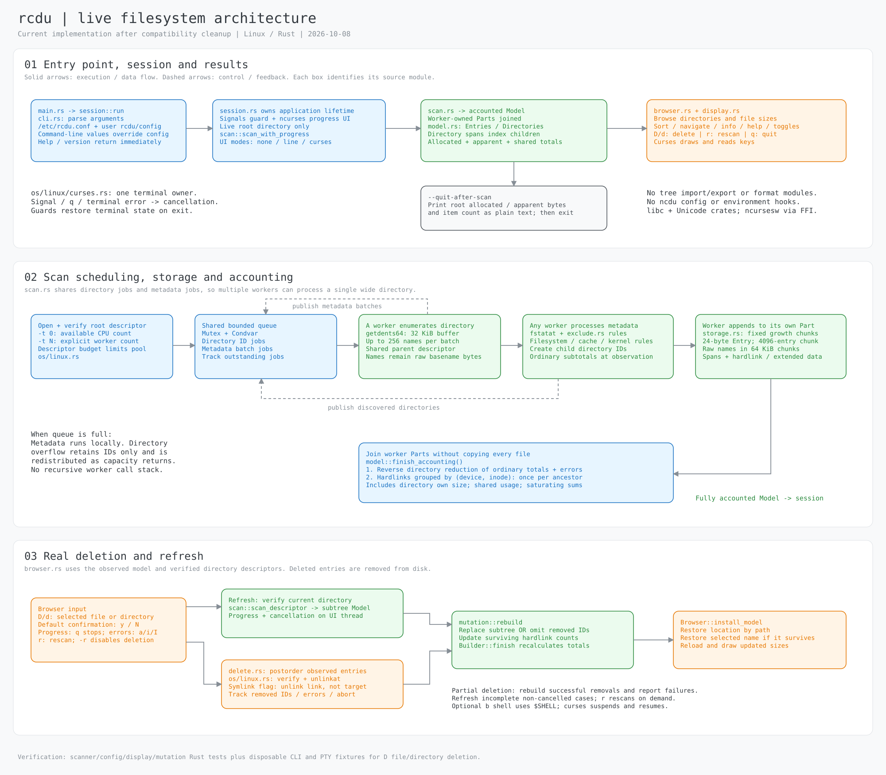
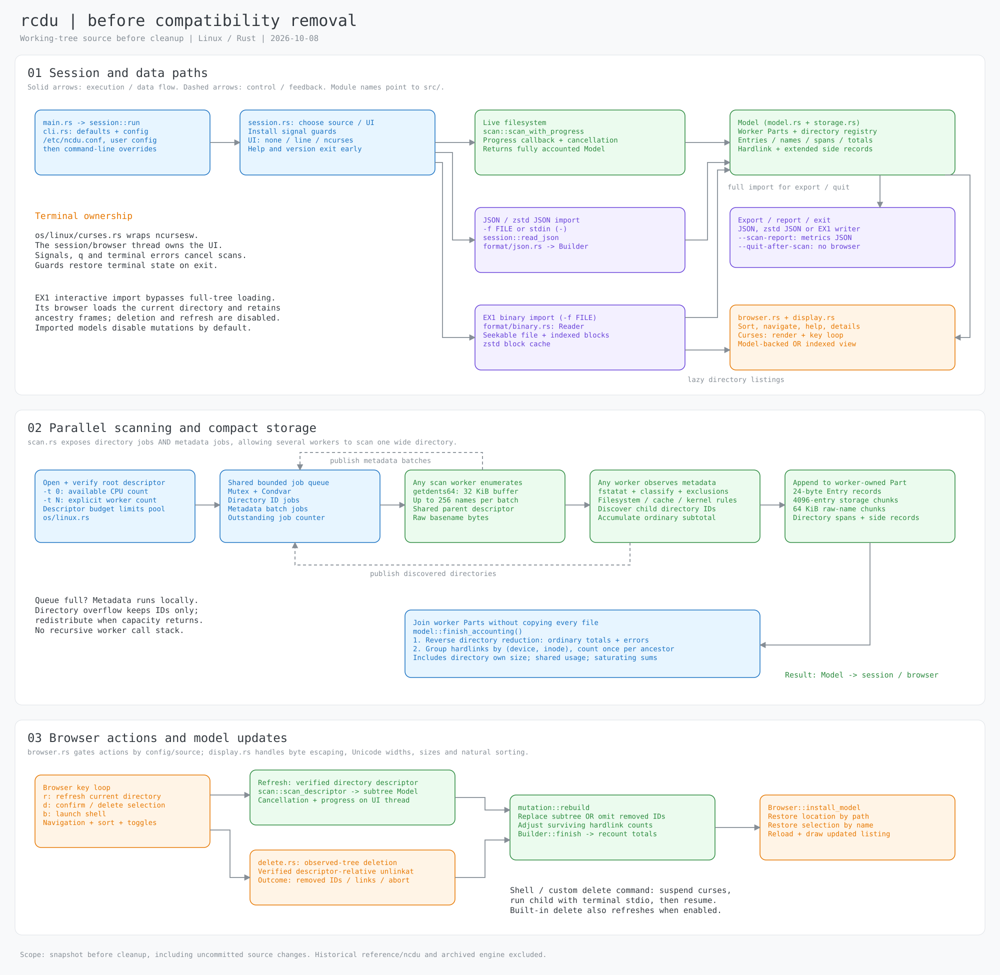

# rcdu

A Linux disk usage scanner and interactive ncurses browser. It scans the live filesystem, calculates allocated and apparent sizes, and lets you navigate, refresh and delete files or directories. Scanning uses available CPUs by default; `-t 1` selects a single worker.

After the first crates.io release, install with Cargo:

```sh
cargo install rcdu 
# or 
cargo install rcdu --locked
```

To build from this checkout:

```sh
scripts/cargo build --release
target/release/rcdu /path/to/directory
target/release/rcdu --quit-after-scan /path/to/directory
```

Use arrows or `hjkl` to navigate, `D` (or `d`) to delete the selected file or directory, `r` to rescan the current directory, and `?` for help. By default, `D` opens a confirmation dialog: press `y` to delete or any other key, including Enter, to cancel. `--no-confirm-delete` makes `D` start immediately; `-r` or `--disable-delete` prevents deletion.

During a directory deletion, rcdu shows progress and `q` stops the remaining work. It deletes the entries found by the last scan, without following directory symlinks. A new child name created after that scan is not traversed and can keep a directory from being removed. Errors offer `a` to abort, `i` to ignore one, or `I` to ignore all; rcdu reports an incomplete deletion afterward. Successful removals update the displayed sizes. Press `r` to scan again when the filesystem has changed outside rcdu.

The app has no saved-tree import/export, JSON/zstd/EX1 formats, ncdu configuration loading, or ncdu environment hooks. Its optional configuration lives at `/etc/rcdu.conf` and `$XDG_CONFIG_HOME/rcdu/config` (default `~/.config/rcdu/config`); command-line arguments override it. `--ignore-config` skips configuration files. `--quit-after-scan` prints plain-text root sizes and exits.

```sh
scripts/cargo test
scripts/cargo build
scripts/integration
scripts/cargo clippy --all-targets -- -D warnings
```

## Recorded benchmark results

The following **historical** scan comparison predates the current cleanup and does not measure the current code. It scanned a synthetic directory of 100,000 empty files on an AMD Ryzen 5 4600H with NVMe storage and a warm filesystem cache. Both programs used release builds, the same explicit worker count and `--ignore-config -0 --quit-after-scan`; five measured runs per setting followed an unmeasured warmup. All recorded runs exited successfully and produced the same normalized scan result.

| Workers | ncdu 2.9.2 median time | ncdu peak RSS | rcdu 0.2.0 median time | rcdu peak RSS |
| ---: | ---: | ---: | ---: | ---: |
| 1 | 0.286 s | 8,348 KiB | 0.161 s | 7,144 KiB |
| 2 | 0.302 s | 8,752 KiB | 0.088 s | 7,188 KiB |
| 4 | 0.161 s | 8,704 KiB | 0.048 s | 7,572 KiB |
| 6 | 0.164 s | 8,752 KiB | 0.040 s | 7,588 KiB |
| 12 | 0.164 s | 8,760 KiB | 0.045 s | 9,476 KiB |

Times and peak RSS values are medians; RSS comes from Linux `wait4` and is reported in KiB. The [raw wide-fixture observations](benchmarks/results/restart-wide-initial.json) contain the commands, build details, ranges and individual runs. [Broad-fixture results](benchmarks/results/rust-model-valid.json) and [later Rust-only large-fixture experiments](benchmarks/results/restart-balanced-large.json) are also available. These synthetic workloads do not establish performance on a real user tree.

## Architecture diagrams

Current architecture ([editable Excalidraw JSON](docs/diagrams/rcdu-architecture.excalidraw.json)):



Architecture before compatibility cleanup ([editable Excalidraw JSON](docs/diagrams/rcdu-before-cleanup.excalidraw.json)):



Open either JSON file in Excalidraw using **Open**.

Every Cargo invocation uses `scripts/cargo` to restrict build/test concurrency to half the available CPU budget; scan concurrency is controlled independently. See [the scan design](docs/redesign.md) and [measurement notes](docs/measurement.md). The linked benchmark results and before-cleanup diagram are historical; they do not describe the current feature set. Required source and license notices remain in [credits](docs/credits.md).
